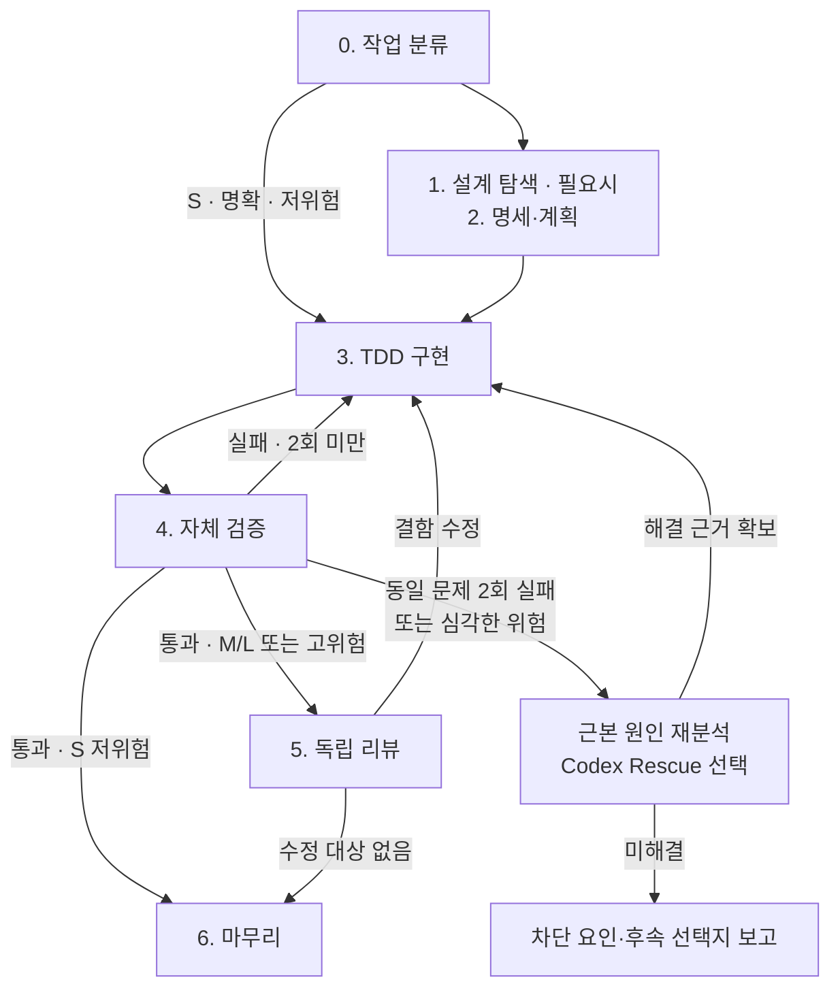

# AI 코딩 워크플로 가이드

> **핵심:** Superpowers가 개발을 주도하고, Matt Pocock은 설계 질문을 보완하며, Ponytail은 복잡도를 줄이고, Codex는 독립 검증한다.

## 1. 운영 원칙

| 원칙 | 적용 기준 |
|---|---|
| **단일 실행 흐름** | Superpowers를 중심으로 운영하고, 다른 구현 체인은 병행하지 않는다. |
| **필요한 단계만** | 범위와 위험도를 따로 평가해 단계를 선택한다. 확정된 결정은 새 근거가 있을 때만 재검토한다. |
| **선택적 설계 질문** | `brainstorming`을 기본으로, 필요할 때만 Matt Pocock Grilling을 사용한다. |
| **TDD 통일** | Superpowers `test-driven-development`만 사용한다. |
| **정확성 우선** | Ponytail로 단순화하되 요구사항·테스트·안전성은 유지한다. |
| **검증 후 완료** | 수용 기준·실행 결과·리뷰 결함 해결을 확인한다. 리뷰는 목적별로 구분하고 필수 절차는 유지한다. |
| **반복 실패 대응** | 같은 문제의 수정·검증이 2회 실패하면 원인을 재분석한다. 심각한 위험은 즉시 분석한다. |

## 2. 한눈에 보는 전체 흐름



| 규모 | 대표 사례 | 기본 경로 |
|---|---|---|
| **S** | 한 동작·국소 수정, 외부 계약·구조 변경 없음 | **3 → 4 → 6** |
| **M** | 기존 구조 안의 기능 추가·여러 모듈 연동 | **1·2(간략) → 3 → 4 → 5 → 6** |
| **L** | 신규 시스템·주요 구조·여러 시스템의 계약 변경 | **1 → 2 → 3 → 4 → 5 → 6** |

**0. 작업 분류:** S/M/L은 변경 범위다. 위험도는 별도로 평가하며, 데이터 손실·보안·호환성·동시성·핵심 알고리즘 정확성에 영향을 주면 S라도 고위험으로 설계 확인·5단계 독립 리뷰를 추가한다. 승인된 명세가 충분하면 1단계를 생략한다.

**Spike 예외:** 사용자와 합의한 연구·기술 검증용 임시 코드는 계획·TDD·리뷰를 간소화할 수 있다. 정식 코드 반영 시 정상 절차로 복귀한다. 선택한 실행 스킬의 필수 리뷰는 유지한다.

## 3. 단계별 실행 방법

요청 예시의 `[경로]` 등은 실제 값으로 바꾼다. 모드 설정 명령은 계획·구현 요청과 별도로 실행한다.

### 1. 설계 탐색 — Superpowers / Matt Pocock (필요시)

- **기본:** `brainstorming`으로 요구사항·대안·수용 기준을 정리하고 설계를 승인받는다.

**요청 예시**

```text
[추가하거나 변경하려는 기능]에 대해 Superpowers brainstorming으로
요구사항과 설계 대안을 구체화해 주세요.
설계 승인 전에는 코드를 작성하거나 수정하지 마세요.
```

- **선택:** 미결 사항은 `/grill-me`, 용어·설계 결정 문서화는 `/grill-with-docs`를 활용한다.

**요청 예시(선택: 질문으로 미결 사항을 탐색할 때)**

```text
/grill-me
정렬 기준과 기본값, 페이지네이션에 대해 놓친 결정이 있는지 질문해 주세요.
```

**요청 예시(선택: 용어·설계 결정도 문서화할 때)**

```text
/grill-with-docs
[추가하거나 변경하려는 기능]의 미결정 사항과 설계 가정을 질문으로 구체화해 주세요.
논의 중 정리된 용어와 중요한 설계 결정은 프로젝트 문서 정책에 따라 기록해 주세요.
```

### 2. 명세·계획 — Superpowers + Ponytail

- Ponytail의 공식 내장 기본은 `full`, 이 가이드의 운영 기본은 `lite`다. **각 세션에서 계획·구현 전에 `/ponytail lite`를 실행**한다. 세션 동안 유지되며 추가 단순화 검토 시에만 `/ponytail full`을 선택한다.
- 문서 저장 위치는 플러그인 기본 경로보다 프로젝트 문서 정책을 우선한다.
- **L:** 승인된 설계로 `writing-plans` 실행. **M:** 간략 계획으로 대체 가능.

**요청 예시**

```text
승인된 설계 [경로]로 Superpowers writing-plans를 실행해 주세요.
테스트 가능한 작업 단위와 검증 방법을 정리하고, 프로젝트 문서 정책에 따라 저장해 주세요.
아직 코드는 수정하지 마세요.
```

### 3. 구현 — Superpowers TDD + Ponytail

**구현 전:** 기존 테스트로 baseline을 기록해 기존 실패와 새 회귀를 구분한다. 기존 실패 시 원인·진행 여부를 확인한다. 격리가 필요하거나 실행 스킬이 요구하면 `using-git-worktrees`로 기존 격리부터 확인한다. S 작업마다 새 공간을 만들지는 않는다.

**RED(실패 테스트) → GREEN(최소 구현) → REFACTOR(정리)** 를 반복한다.

의도적으로 제한이 있는 단순한 해법을 채택하면 코드에 `shortcut: <현재 한계>, <재검토 조건>` 주석을 남긴다. 서브에이전트에 구현을 위임할 때도 이 기준을 전달한다.

| 상황 | Superpowers 스킬 |
|---|---|
| 계획의 작업을 분리할 수 있고 작업별 구현·리뷰를 위임 | `subagent-driven-development`: 작업마다 새 구현 에이전트 + 명세·품질 리뷰, 마지막 전체 브랜치 리뷰 |
| 사용자가 직접 구현을 선택했거나 서브에이전트 도구가 없음 | `executing-plans`: 현재 세션에서 직접 구현·TDD, 작업별 리뷰 없이 마지막 전체 브랜치 리뷰 |
| 원인 불명의 버그 | `systematic-debugging` 후 수정 |

둘 다 현재 세션에서 대체로 독립적인 계획 작업을 실행하며, S/M도 이 스킬을 선택하면 실행 가능한 계획이 필요하다. 높은 결합도로 실행이 어려우면 계획·작업 경계를 먼저 재검토한다. 도구가 없어 직접 구현하면 최종 리뷰는 공식 절차대로 별도 자체 리뷰를 수행하고 한계를 보고한다.

**요청 예시(계획 실행 시)** — `[실행 스킬]`에는 위 기준에 따라 `subagent-driven-development` 또는 `executing-plans` 중 하나를 넣는다.

```text
승인된 계획 [경로]를 Superpowers [실행 스킬]로 실행해 주세요.
구현에는 test-driven-development를 적용해 실패 테스트를 먼저 작성하고,
통과시킨 뒤 리팩토링해 주세요.
```

**동일 문제의 수정·검증 사이클 2회 실패 시:** 환경 장애와 코드 결함을 구분하고 로그·수정 이력으로 `systematic-debugging`을 수행한다. 필요하면 Codex Rescue로 독립 진단한다. 단순 재실행은 횟수에 넣지 않으며, 데이터 손실·보안 등 심각한 위험은 즉시 분석한다.

**요청 예시(선택: 독립 진단)**

```text
/codex:rescue --fresh 동일한 문제의 수정·검증 사이클이 두 번 실패했습니다.
현재 git diff, [실패 로그 경로], [이전 수정 시도 기록 경로]를 검토해
근본 원인과 최소 수정 방안을 제시해 주세요. 코드는 변경하지 마세요.
```

원인 확인 후 수정·재검증한다. 재분석 후에도 미해결이면 반복을 멈추고 차단 요인·시도·후속 선택지를 보고한다.

### 4. 자체 검증 — Superpowers 필수 / Ponytail 선택

- **필수:** `verification-before-completion`으로 수용 기준 충족, 관련 테스트·프로젝트 테스트 스위트, 적용 가능한 정적 검사·통합 테스트 결과, 리뷰 결함 해결을 확인한다. 테스트 통과만으로 완료하지 않는다.
- **Superpowers:** 명세 충족·구현 정확성을 검증한다. 실행 스킬의 작업별·최종 리뷰를 그대로 수행하고 같은 범위의 일반 리뷰를 별도 추가하지 않는다.

**요청 예시**

```text
Superpowers verification-before-completion으로 수용 기준 충족 여부를 확인해 주세요.
프로젝트에서 정한 테스트·정적 검사를 실행하고 결과를 확인해 주세요.
리뷰 지적사항의 처리 상태, 실행하지 못한 검사와 잔여 위험을 보고하고
완료 가능 여부를 판단해 주세요.
```

- **Ponytail(선택):** 추가 검토가 필요할 때 불필요한 복잡도·과잉 추상화에 초점을 둔다. 공식 리뷰는 버그·안전성도 다루므로 기존 지적은 중복 처리하지 않는다. 커밋된 변경까지 보려면:

**요청 예시(선택)**

```text
/ponytail-review branch
```

- **저장소 전반 진단(선택):** 인수·대규모 리팩터링 전·정기 점검에 `/ponytail-audit`을 사용한다. 버그·보안·성능·테스트 누락·복잡성을 진단하며 코드는 수정하지 않는다.

**요청 예시(선택)**

```text
/ponytail-audit
```

**지적사항 처리:** 5단계 공통 기준을 적용하며, Superpowers 내부 수정·재리뷰는 해당 실행 스킬의 절차를 따른다.

### 5. 독립 검증 — Codex

자체 검증을 통과한 **M/L 및 고위험 변경은 Codex로 독립적인 버그·회귀 위험을 검토**한다. 앞선 지적과 통합 관리한다.

`<비교 기준 브랜치>`는 실제 대상(예: `main`, `develop`, `release/1.0`)으로 바꾼다. `--base`는 커밋된 브랜치 변경 대상이며, 미커밋 변경은 `--base` 대신 `--scope working-tree`로 검토한다. 일반 `/codex:review`에는 집중 검토 문구를 붙일 수 없다.

**요청 예시**

```text
/codex:review --base <비교 기준 브랜치>
```

**Adversarial Review(선택):** 고위험 설계 가정·실패 시나리오를 검토할 때 사용한다.

**요청 예시(선택)**

```text
/codex:adversarial-review --base <비교 기준 브랜치>
현재 설계의 핵심 가정과 선택 근거를 검토하고,
가정이 깨지는 조건과 실패 시나리오를 찾아주세요.
```

**리뷰 후 처리 (공통)**

1. 기술적 근거·실제 영향을 확인하고 수용·반려·보류 사유를 기록한다.
2. 수용한 결함의 수정·보류는 해당 스킬의 절차를 따른다. 설계 변경은 먼저 승인받는다.
3. 관련 테스트·검사를 재실행한다.
4. 필요한 재리뷰는 해당 스킬의 절차를 따르며, 유효한 Critical·Important 결함은 완료 전에 해결한다.

**완료 조건:** 유효한 Critical·Important 결함은 해결한다. 미해결이면 보류 사유·위험·후속 조치를 보고하며 완료로 처리하지 않는다. Codex 리뷰는 읽기 전용이므로 판정·수정은 리뷰 후 별도로 수행한다.

**요청 예시(리뷰 후)**

```text
리뷰 지적사항의 근거와 실제 영향으로 심각도를 판단하고, 수용·반려·보류 사유를 기록해 주세요.
유효한 Critical·Important 결함을 수정하고, Minor는 해당 실행 스킬의 절차에 따라 처리해 주세요.
관련 테스트를 재실행하고 수정 내용과 남은 위험을 알려 주세요.
설계 변경이 필요하면 먼저 확인해 주세요.
```

### 6. 마무리 — Superpowers

`finishing-a-development-branch`로 4·5단계의 완료 조건을 확인하고 통합 방안을 제시한다. 수용 기준·검사 결과·미실행 테스트·리뷰 처리·잔여 위험을 함께 보고한다.

**요청 예시**

```text
Superpowers finishing-a-development-branch로 최종 검증 상태를 확인하고
완료 또는 통합 선택지를 제시해 주세요.
```

**기술 부채(선택):** `/ponytail-debt`로 코드의 `shortcut:` 주석에 기록된 한계와 재검토 조건을 수집한다.

---

## 4. 스킬 빠른 참조

이 가이드에서 사용하는 **주요 스킬만** 정리했다. Superpowers는 스킬 이름을 자연어로 요청하거나 자동 활성화할 수 있다. 나머지 `/...`는 직접 입력하는 명령어다.

### Superpowers

| 명령어·스킬 | 주요 기능 | 권장 사용 시점 | 요청 예시 |
|---|---|---|---|
| `brainstorming` | 요구사항·대안·설계 정렬 | 구현 전, 설계가 불명확할 때 | "요구사항을 질문으로 정리하고 설계를 제안해 주세요." |
| `writing-plans` | 테스트 가능한 구현 계획 작성 | 설계 승인 후 L 작업 | "승인된 설계를 작업 단위로 나눠 주세요." |
| `test-driven-development` | RED → GREEN → REFACTOR | 코드 구현 시 | "실패 테스트부터 작성해 구현해 주세요." |
| `subagent-driven-development` | 작업별 구현 위임·명세/품질 리뷰 + 최종 리뷰 | 독립 작업 계획, 작업별 리뷰가 필요할 때 | "독립 작업을 서브에이전트로 구현해 주세요." |
| `executing-plans` | 현재 세션 직접 구현·TDD + 최종 리뷰 | 직접 구현 선택 또는 서브에이전트 도구 없음 | "승인된 계획을 순서대로 실행해 주세요." |
| `systematic-debugging` | 증거 기반 근본 원인 분석 | 원인 불명 오류·반복 실패 | "로그로 실패 원인을 먼저 밝혀 주세요." |
| `verification-before-completion` | 테스트·검증 결과 확인 | 구현·수정 완료 전 | "테스트를 실행하고 결과를 확인해 주세요." |
| `finishing-a-development-branch` | 최종 검증·완료 선택지 제시 | 전체 구현·리뷰 후 | "최종 상태를 확인하고 마무리 방안을 제시해 주세요." |

### Matt Pocock Skills

| 명령어 | 주요 기능 | 권장 사용 시점 | 요청 예시 |
|---|---|---|---|
| `/grill-me` | 질문으로 미결정 사항·가정 탐색 | 설계 초안에 빈틈이 있을 때 | "예외 상황과 기본값의 미결정 사항을 질문해 주세요." |
| `/grill-with-docs` | 설계 질문과 용어·중요 결정 기록 | 공통 용어·결정 근거를 남길 때 | "모호한 용어를 정리하고 중요한 결정을 기록해 주세요." |
| `/improve-codebase-architecture` | 구조 개선 후보 탐색·HTML 보고서 생성(코드 수정 없음) | 기존 코드 진단·대규모 개발 전·주기적 구조 점검 | "변경이 잦은 모듈에서 테스트 용이성을 높일 구조 개선 후보를 찾아주세요." |

### Ponytail

| 명령어 | 주요 기능 | 권장 사용 시점 | 요청 예시 |
|---|---|---|---|
| `/ponytail lite` · `/ponytail full` | 구현 간결성 강도 설정 | 세션 시작 시 `lite` 지정 (공식 기본 `full`) | `/ponytail lite` |
| `/ponytail-review branch` | 현재 브랜치 변경 코드 리뷰 | 추가 복잡도 검토가 필요할 때 | `/ponytail-review branch` |
| `/ponytail-audit` | 저장소 전체 코드 품질 진단 | 인수·대규모 리팩터링 전·정기 점검 | `/ponytail-audit` |
| `/ponytail-debt` | `shortcut:`으로 표시한 기술 부채 수집 | 마무리·유지보수 시 | `/ponytail-debt` |

### Codex Plugin

| 명령어 | 주요 기능 | 권장 사용 시점 | 요청 예시 |
|---|---|---|---|
| `/codex:review` | 읽기 전용 버그·회귀 리뷰 | 자체 검증을 통과한 M/L·고위험 작업 | `/codex:review --base <비교 기준 브랜치>` |
| `/codex:adversarial-review` | 설계 가정·실패 시나리오 비판 | 고위험·주요 설계 변경 | `/codex:adversarial-review --base <비교 기준 브랜치>` |
| `/codex:rescue` | 버그 분석·명시적 수정 위임 | 반복 실패·독립 진단 필요 시 | `/codex:rescue --fresh 오류의 원인만 분석해 주세요. 코드 수정은 하지 마세요.` |

---

**참고:** [Superpowers](https://github.com/obra/superpowers) · [Matt Pocock Skills](https://github.com/mattpocock/skills) · [Ponytail](https://github.com/DietrichGebert/ponytail) · [Codex Plugin](https://github.com/openai/codex-plugin-cc)  
*대조 기준: Claude Code 설치본 Superpowers 7.0.0, Ponytail 5.2.0, Codex Plugin 1.0.6, Matt Pocock Skills 1.3.1 및 공식 저장소의 README·스킬/명령 정의. 업데이트 후에는 설치된 정의를 다시 확인하며, 명령 예시는 Claude Code용이다.*
