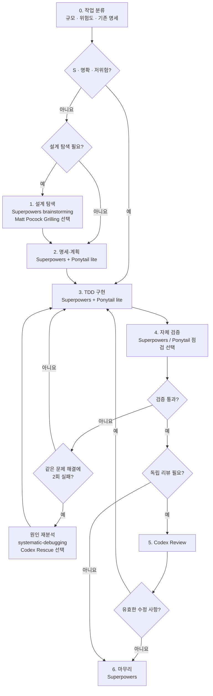

# AI 코딩 워크플로 가이드

> **핵심:** Superpowers가 개발을 주도하고, Matt Pocock은 설계 질문을 보완하며, Ponytail은 복잡도를 줄이고, Codex는 독립 검증한다.

## 1. 운영 원칙

| 원칙 | 적용 기준 |
|---|---|
| **단일 실행 흐름** | Superpowers를 중심으로 운영하고, 다른 구현 체인은 병행하지 않는다. |
| **필요한 단계만** | 규모·위험도에 따라 단계를 선택하고 확정된 결정은 재논의하지 않는다. |
| **선택적 설계 질문** | `brainstorming`을 기본으로, 필요할 때만 Matt Pocock Grilling을 사용한다. |
| **TDD 통일** | Superpowers `test-driven-development`만 사용한다. |
| **정확성 우선** | Ponytail로 단순화하되 요구사항·테스트·안전성은 유지한다. |
| **검증 후 완료** | 실행 결과를 확인하고 리뷰는 판정 → 수정 → 재검증한다. Codex는 독립 리뷰를 담당한다. |
| **반복 실패 대응** | 같은 문제의 수정·검증이 2회 실패하면 반복 수정을 멈추고 원인을 재분석한다. |

## 2. 한눈에 보는 전체 흐름



| 규모 | 대표 사례 | 기본 경로 |
|---|---|---|
| **S** | 범위가 좁고 요구사항이 명확한 수정 | **3 → 4 → 6** |
| **M** | 일반 기능 추가, 여러 파일 수정 | **1·2(간략) → 3 → 4 → 5 → 6** |
| **L** | 신규 시스템, 주요 구조 변경 | **1 → 2 → 3 → 4 → 5 → 6** |

**분기:** 승인된 명세가 충분하면 1단계를 생략한다. 소규모라도 고위험 변경은 설계 확인·독립 리뷰를 추가한다.

## 3. 단계별 실행 방법

### 1. 설계 탐색 — Superpowers / Matt Pocock (필요시)

- **기본:** `brainstorming`으로 요구사항·대안·수용 기준을 정리하고 설계를 승인받는다.
- **선택:** 미결 사항은 `/grill-me`, 용어·설계 결정 문서화는 `/grill-with-docs`를 활용한다.

**요청 예시**
> 검색 결과에 정렬 기능을 추가하려고 합니다. Superpowers brainstorming으로 요구사항과 설계 대안을 구체화해 주세요. 설계 승인 전에는 구현하지 마세요.

```text
/grill-me
정렬 기준과 기본값, 페이지네이션에 대해 놓친 결정이 있는지 질문해 주세요.
```

### 2. 명세·계획 — Superpowers + Ponytail

- **L:** 승인된 설계로 `writing-plans` 실행. **M:** 간략 계획으로 대체 가능.
- `/ponytail lite`로 불필요한 클래스·추상화·의존성을 억제한다.

**요청 예시**
> 승인된 설계로 Superpowers writing-plans를 실행해 주세요. 테스트 가능한 작업 단위와 검증 방법을 정리하고, 아직 코드는 수정하지 마세요.

### 3. 구현 — Superpowers TDD + Ponytail

**RED(실패 테스트) → GREEN(최소 구현) → REFACTOR(정리)** 를 반복한다.

| 상황 | Superpowers 스킬 |
|---|---|
| 독립 작업 | `subagent-driven-development` |
| 순차 구현 | `executing-plans` |
| 원인 불명의 버그 | `systematic-debugging` 후 수정 |

**요청 예시**
> 승인된 계획을 Superpowers test-driven-development로 구현해 주세요. 실패 테스트를 먼저 작성하고 통과시킨 뒤 리팩토링해 주세요.

Ponytail은 `lite`를 기본으로, 과도한 복잡성이 반복될 때만 `/ponytail full`을 적용한다. 필수 기능·테스트는 유지한다.

**동일 문제 해결에 2회 실패 시:** 반복 수정을 중단하고 오류 로그·수정 이력을 검토한다. `systematic-debugging`으로 원인을 재분석하고, 필요하면 Codex Rescue에 독립 분석을 요청한다. (단순 테스트 재실행 2회가 아닌 **수정·검증 사이클 2회 실패** 기준)

```text
/codex:rescue --fresh 동일한 문제의 수정·검증이 두 번 실패했습니다.
오류 로그와 앞선 수정 시도를 검토해 근본 원인과 해결책을 제시해 주세요.
우선 코드는 변경하지 마세요.
```

원인이 확인되면 수정 → 테스트를 재실행하고, 큰 변경은 다시 리뷰한다.

### 4. 자체 검증 — Superpowers / Ponytail (선택)

- `verification-before-completion`: 테스트·정적 검사·필요한 통합 테스트를 실행하고 결과를 확인한다.
- 변경 코드의 복잡도를 점검할 때는 커밋된 변경도 포함하는 브랜치 리뷰를 사용한다.

```text
/ponytail-review branch
```

- **저장소 전반 진단(선택):** 인수·대규모 리팩터링 전·정기 점검에 `/ponytail-audit`을 사용한다. 버그·보안·성능·테스트 누락·복잡성을 진단하며 코드는 수정하지 않는다.

```text
/ponytail-audit
```

**지적사항 발견 시** 타당한 항목만 수정하고 테스트를 재실행한다. 중요한 변경은 재리뷰한다.

> 리뷰 지적사항의 근거를 검토하고 타당한 항목만 수정해 주세요. 필요한 테스트를 보완·실행하고, 반영하지 않은 항목은 이유를 설명해 주세요.

### 5. 독립 검증 — Codex

자체 검증을 통과한 M/L 및 고위험 변경의 버그·회귀·설계 위험을 검토한다.

```text
/codex:review --base main
```

특정 위험을 집중 검토할 때만:

```text
/codex:adversarial-review --base main challenge data loss and concurrency risks
```

`main`은 실제 비교 기준 브랜치로 바꾼다.

**리뷰 후 처리 (Ponytail·Codex 공통)**

```text
지적사항 판정(수용 / 반려 / 보류)
        ↓
수용한 항목 수정 (설계 변경 시 재승인)
        ↓
관련 테스트·검사 재실행
        ↓
중대한 수정이면 재리뷰 → 미해결 중대 결함이 없으면 완료
```

**요청 예시**
> 리뷰 결과를 근거와 함께 분류하고, 수용한 문제만 수정해 주세요. 관련 테스트를 재실행하고 수정 내용과 남은 위험을 알려 주세요. 설계 변경이 필요하면 먼저 확인해 주세요.

### 6. 마무리 — Superpowers

`finishing-a-development-branch`로 검증 상태를 확인하고 완료·통합 방안을 제시한다.

**기술 부채(선택):** 의도적으로 미룬 개선사항은 `/ponytail-debt`로 수집하고, 제약·개선 조건에 따라 후속 관리한다.

**요청 예시**
> Superpowers finishing-a-development-branch로 최종 검증 상태를 확인하고 완료 또는 통합 선택지를 제시해 주세요.

---

## 4. 스킬 빠른 참조

이 가이드에서 사용하는 **주요 스킬만** 정리했다. Superpowers는 스킬 이름을 자연어로 요청하거나 자동 활성화할 수 있다. 나머지 `/...`는 직접 입력하는 명령어다.

### Superpowers

| 명령어·스킬 | 주요 기능 | 권장 사용 시점 | 요청 예시 |
|---|---|---|---|
| `brainstorming` | 요구사항·대안·설계 정렬 | 구현 전, 설계가 불명확할 때 | "요구사항을 질문으로 정리하고 설계를 제안해 주세요." |
| `writing-plans` | 테스트 가능한 구현 계획 작성 | 설계 승인 후 L 작업 | "승인된 설계를 작업 단위로 나눠 주세요." |
| `test-driven-development` | RED → GREEN → REFACTOR | 코드 구현 시 | "실패 테스트부터 작성해 구현해 주세요." |
| `subagent-driven-development` | 독립 작업별 서브에이전트 실행·리뷰 | 계획이 있고 작업을 분리할 수 있을 때 | "독립 작업을 서브에이전트로 구현해 주세요." |
| `executing-plans` | 현재 세션에서 계획 순차 실행 | 작업 간 결합도가 높거나 단일 세션 구현 시 | "승인된 계획을 순서대로 실행해 주세요." |
| `systematic-debugging` | 증거 기반 근본 원인 분석 | 원인 불명 오류·반복 실패 | "로그로 실패 원인을 먼저 밝혀 주세요." |
| `verification-before-completion` | 테스트·검증 결과 확인 | 구현·수정 완료 전 | "테스트를 실행하고 결과를 확인해 주세요." |
| `finishing-a-development-branch` | 최종 검증·완료 선택지 제시 | 전체 구현·리뷰 후 | "최종 상태를 확인하고 마무리 방안을 제시해 주세요." |

### Matt Pocock Skills

| 명령어 | 주요 기능 | 권장 사용 시점 | 요청 예시 |
|---|---|---|---|
| `/grill-me` | 질문으로 미결정 사항·가정 탐색 | 설계 초안에 빈틈이 있을 때 | "예외 상황과 기본값의 미결정 사항을 질문해 주세요." |
| `/grill-with-docs` | 설계 질문과 용어·중요 결정 기록 | 공통 용어·결정 근거를 남길 때 | "모호한 용어를 정리하고 중요한 결정을 기록해 주세요." |
| `/improve-codebase-architecture` | 구조 개선 후보 탐색·HTML 보고서 생성(코드 수정 없음) | 기존 코드 진단·대규모 개발 전·주기적 구조 점검 | "변경이 잦은 모듈에서 테스트 용이성을 높일 구조 개선 후보를 찾아주세요." |

### Ponytail

| 명령어 | 주요 기능 | 권장 사용 시점 | 요청 예시 |
|---|---|---|---|
| `/ponytail lite` · `/ponytail full` | 구현 간결성 강도 설정 | 계획·구현 중 (`lite` 기본) | `/ponytail lite` |
| `/ponytail-review branch` | 현재 브랜치 변경 코드 리뷰 | 기능 구현 후 | `/ponytail-review branch` |
| `/ponytail-audit` | 저장소 전체 코드 품질 진단 | 인수·대규모 리팩터링 전·정기 점검 | `/ponytail-audit` |
| `/ponytail-debt` | `shortcut:`으로 표시한 기술 부채 수집 | 마무리·유지보수 시 | `/ponytail-debt` |

### Codex Plugin

| 명령어 | 주요 기능 | 권장 사용 시점 | 요청 예시 |
|---|---|---|---|
| `/codex:review` | 읽기 전용 독립 코드 리뷰 | 자체 검증을 통과한 M/L 작업 | `/codex:review --base main` |
| `/codex:adversarial-review` | 설계 가정·실패 시나리오 비판 | 고위험·주요 설계 변경 | `/codex:adversarial-review --base main challenge error handling` |
| `/codex:rescue` | 버그 분석·수정 작업 위임 | 동일 문제 해결에 2회 실패 등 | `/codex:rescue --fresh 오류의 원인만 분석해 주세요. 코드 수정은 하지 마세요.` |

---

**참고:** [Superpowers](https://github.com/obra/superpowers) · [Matt Pocock Skills](https://github.com/mattpocock/skills) · [Ponytail](https://github.com/DietrichGebert/ponytail) · [Codex Plugin](https://github.com/openai/codex-plugin-cc)  
*명령어와 옵션은 설치된 스킬 버전에 따라 달라질 수 있다.*
